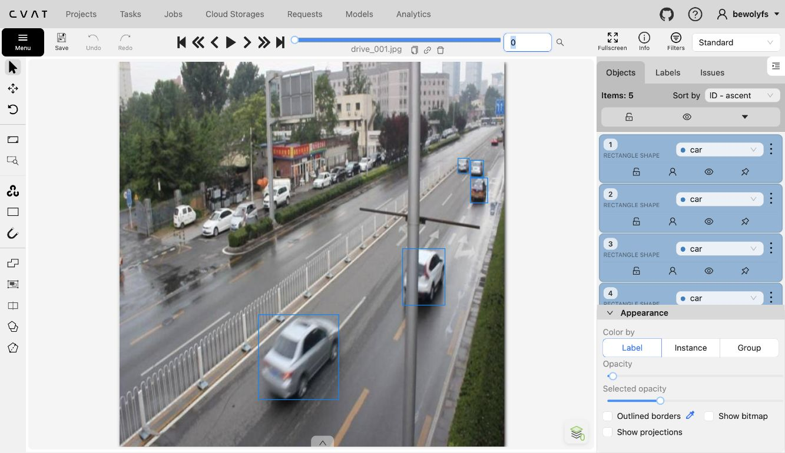
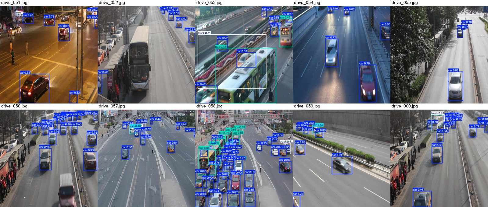

# Báo cáo cá nhân — Ngày 2 Object Detection

**Trạng thái ngày 09/11/2026: đã hoàn thành annotation QC và train/eval YOLO local trong PyCharm.** Mục 4 trình bày quá trình phát hiện lệch ID lớp, rework nhãn và kiểm tra lại; mục 5 trình bày kết quả mô hình.

## 1. Thông tin học viên

- Họ tên: Hoàng Minh Hải.
- MSSV: 2A202603275.
- Email: 26ai.haihm@vinuni.edu.vn.
- Khóa: AI20K K5, Level 2. Chưa bổ sung tên lớp/nhóm cụ thể L2A hoặc L2B.
- Repo: [K5-L2-DAY02-HoangMinhHai-2A202603275-ObjectDetection](https://github.com/abuhmhai/K5-L2-DAY02-HoangMinhHai-2A202603275-ObjectDetection).
- Môi trường thực hiện annotation và QC: CVAT local, PyCharm và Python trên Mac.
- Hình thức chạy pipeline: local trên PyCharm, dùng Apple GPU/MPS. Không có phiên Colab đã chạy; cần giảng viên xác nhận hình thức local thay cho yêu cầu link Colab trong SUBMISSION. Mã tái lập: [train_yolo_local.py](../../tools/train_yolo_local.py).

## 2. Schema và mini guideline

Chi tiết trong [GUIDELINE_MINI.md](../../GUIDELINE_MINI.md).

| Lớp | ID trong đề/bản đầu | ID trong bản rework hiện tại |
|---|---:|---:|
| car | 0 | 0 |
| truck | 1 | 2 |
| bus | 2 | 3 |
| van | 3 | 1 |

Ban đầu tôi gán nhãn theo thứ tự lớp trong đề: `car=0, truck=1, bus=2, van=3`. Sau khi nhận gold và đối chiếu các đối tượng trong ảnh, tôi phát hiện thứ tự ID của gold khác với bản đang dùng: `car=0, van=1, truck=2, bus=3`. Vì evaluator so khớp theo cả ID lớp và IoU, cùng một loại xe có thể bị tính sai lớp khi hai bộ nhãn chưa thống nhất mã.

Tôi đã rework để đồng bộ ID trên task CVAT, `data.yaml` và file nhãn YOLO xuất ra theo thứ tự đối chiếu được từ gold. Ở bước đổi ID, tên loại xe và tọa độ box được giữ nguyên; sau đó tôi xuất lại **Ultralytics YOLO Detection 1.0** và chạy evaluator trên đúng thư mục nhãn học viên.

Ba ca mơ hồ đã ghi nhận:

1. `drive_007`: xe có thân dạng van/minivan chở khách, dễ nhầm với car hoặc bus. Giữ `van`, ID hiện tại là 1.
2. `drive_016`: xe rất nhỏ, mờ ở sát mép trên ảnh; nhãn cũ là truck nhưng không đủ rõ khoang hàng. Loại trong bản rework thử, chưa chốt một lớp thay thế.
3. `drive_046`: xe ở xa phía trên trái, khó phân biệt car và van. Box nhỏ này được loại trong lượt rà phạm vi nhãn sau đối chiếu gold; chưa xác định lại lớp vì ảnh không đủ rõ.

## 3. Annotation và self-QC

- Có 50 file nhãn tại [dataset/labels/train](../../dataset/labels/train), tương ứng 50 ảnh `drive_001`–`drive_050`.
- Bản hiện tại có 653 box. Mỗi dòng gồm class ID và bốn tọa độ YOLO chuẩn hóa.
- Checker cấu trúc đã chạy đạt **50/50 file hợp lệ**. Checker không chứng minh nhãn đầy đủ hoặc đúng nội dung.
- Đã có lượt rà ảnh với AI hỗ trợ trên cả 50 ảnh. Các ví dụ được xem và xử lý gồm `drive_001`, `drive_005`, `drive_006`, `drive_007`, `drive_010`, `drive_011`, `drive_012`, `drive_015`, `drive_016`, `drive_017`, `drive_041`, `drive_046` và `drive_050`.
- Đã bổ sung xe bị cắt mép/bỏ sót ở các ảnh 005, 006, 010, 011, 015; căn một số khung lệch ở 016, 017, 041 và 050. Các lượt sửa sau đó được ghi trong mục 4.
- Commit bản đầu để đối chiếu: [`1ecbfbb` — update](https://github.com/abuhmhai/K5-L2-DAY02-HoangMinhHai-2A202603275-ObjectDetection/commit/1ecbfbbb54bfd497d54382fd00fed1ad93b83cda). Commit có thời gian 18:56 ngày 09/11/2026, UTC+7. Việc khóa/nộp đúng mốc lớp cần được đối chiếu với xác nhận trên LMS; không suy ra chỉ từ thời gian commit.



## 4. Phát hiện lệch ID, rework và kiểm tra lại

Kết quả sau cùng được chạy trên đúng `dataset/labels/train`, lấy từ **task 2 / job 2** của học viên, xuất **Ultralytics YOLO Detection 1.0**. Task 4 / job 3 là gold tham chiếu, không dùng bản xuất của task đó làm nhãn train.

| Chỉ số | Lần đầu đã lưu | Bản sau rework |
|---|---:|---:|
| TP | 438 | 553 |
| FP | 660 | 100 |
| FN | 215 | 100 |
| Precision | 0,3989 | 0,8469 |
| Recall | 0,6708 | 0,8469 |
| F1 | 0,5003 | **0,8469** |
| Mean IoU của matches | 0,8160 | **0,8265** |
| Passed | false | **true** |

Nguồn: [JSON lần đầu](assets/annotation_qc/evaluation_initial.json), [JSON sau rework](assets/annotation_qc/evaluation_after_rework.json) và [JSON cần nộp](../../outputs/annotation_evaluation.json). Mức tăng F1 gồm hai phần: đồng bộ ID lớp và điều chỉnh phạm vi box trong các lượt QC.

Các bước rework chính:

| Bước | Xử lý | F1 ghi nhận |
|---|---|---:|
| Sửa khung và bổ sung xe | Sửa các trường hợp có thể nhận diện từ ảnh | 0,5154 |
| Thử bỏ xe đỗ/mơ hồ | Loại 147 box được nhận định là xe đỗ và 2 box mơ hồ ở 19 ảnh | 0,5581 |
| Đồng bộ ID lớp | Đổi từ schema đề sang thứ tự ID đối chiếu được trong gold; giữ tên loại xe và tọa độ box | 0,6874 |
| Rà box nhỏ/xa sau đối chiếu | Trong nhóm chưa khớp gold, loại 303 box nhỏ/xa có cạnh ngắn dưới 32 px ở 42 ảnh; giữ tọa độ các box còn lại | 0,8469 |

**Diễn giải kết quả:** đồng bộ ID giúp F1 tăng từ **0,5581 lên 0,6874**; sau lượt rà và loại nhóm box nhỏ/xa nêu trên, F1 đạt **0,8469**. Vì vậy, kết quả cuối là kết quả của cả quá trình rework, không chỉ riêng thao tác đổi ID. Bản hiện tại còn 100 FP và 100 FN.

Phương pháp chấm được giữ nguyên: cùng lớp, IoU ≥ 0,50, ghép một-một; không sửa gold hoặc hạ ngưỡng evaluator. Việc điều chỉnh phạm vi xe đỗ/box nhỏ được thực hiện sau khi xem gold; ngưỡng cạnh ngắn 32 px là lựa chọn trong lượt QC này, chưa được giảng viên xác nhận thành quy tắc chung. Bản đầu và kết quả từng bước được giữ để đối chiếu.

Lệnh tái lập từ thư mục gốc repo:

```bash
./.venv/bin/python tools/check_yolo_labels.py
./.venv/bin/python tools/evaluate_annotations.py \
  --student-labels dataset/labels/train \
  --gold-labels gold_train_labels \
  --output outputs/annotation_evaluation.json
```

Gold train chỉ giữ trên máy, không commit vào repo hoặc đưa lên môi trường train công khai.

## 5. Kết quả YOLO — đã chạy local trong PyCharm

Đã train **YOLO26n pretrained, 50 epoch** trên 50 ảnh train, đánh giá best checkpoint trên 10 ảnh eval và xuất đủ 10 ảnh prediction. Cửa sổ Run của PyCharm kết thúc với **exit code 0**. Toàn bộ train/val/predict và lưu assets mất **328.6 giây** (khoảng 5.48 phút).

### Môi trường và cấu hình tái lập

- Python 3.12.16; Ultralytics 8.4.208; Torch 2.15.0; Torchvision 0.29.2.
- Device `mps` trên Mac Apple Silicon, RAM 16 GB. Có cảnh báo một số phép toán MPS chưa deterministic hoàn toàn; seed không bảo đảm kết quả giống từng bit khi chạy lại.
- Model `yolo26n.pt`; `epochs=50`, `imgsz=640`, `batch=4`, `workers=0`, `seed=20260909`, `amp=False`.
- Optimizer `auto` chọn AdamW, learning rate khởi tạo 0,00125, momentum 0,9. Cấu hình đầy đủ: [args.yaml](assets/yolo26_runs/vehicle_annotation/args.yaml).
- Khác notebook gốc: chạy local bằng MPS thay CUDA/CPU, dùng batch cố định 4 thay AutoBatch để phù hợp RAM, workers 0 và không dùng mixed precision. Dữ liệu được trỏ bằng đường dẫn tuyệt đối trong file cấu hình local tại outputs; giữ nguyên split 50 train/10 eval.
- Best checkpoint: `outputs/yolo26_runs/vehicle_annotation/weights/best.pt`. Theo log CSV, epoch 46 có mAP50–95 validation tốt nhất. Model đã được load lại để val/predict, không dùng mặc định last checkpoint.
- [Thông tin phiên chạy và hash dữ liệu](assets/local_run_manifest.json). Hash toàn bộ ảnh/nhãn train và eval được kiểm tra lại sau run, không có thay đổi trong quá trình chạy. Script không sử dụng gold train để fit model.

### Metrics thực tế trên 10 ảnh eval

| Chỉ số | Giá trị | Phần trăm |
|---|---:|---:|
| Precision | 0.763525 | 76.35% |
| Recall | 0.564982 | 56.50% |
| mAP50 | 0.655033 | 65.50% |
| mAP50–95 | 0.408906 | 40.89% |

Nguồn: [model_eval_metrics.json](assets/model_eval_metrics.json). Precision/recall là các giá trị Ultralytics trả về khi validation; không đồng nhất với cách đếm TP/FP/FN thủ công ở ngưỡng predict 0,25, và không phải F1 annotation 0,8469.

| Lớp | Số nhãn train | Số nhãn eval | Precision | Recall | mAP50 | mAP50–95 |
|---|---:|---:|---:|---:|---:|---:|
| car | 494 | 94 | 0.9226 | 0.7766 | 0.9027 | 0.5781 |
| van | 59 | 5 | 0.5712 | 0.4000 | 0.4349 | 0.3222 |
| truck | 20 | 2 | 0.5994 | 0.5000 | 0.4950 | 0.3465 |
| bus | 80 | 12 | 0.9609 | 0.5833 | 0.7876 | 0.3889 |

### Log và ảnh kết quả

- [Log 50 epoch — results.csv](assets/yolo26_runs/vehicle_annotation/results.csv).
- [Đường loss và metrics](assets/yolo26_runs/vehicle_annotation/results.png).
- [PR curve](assets/yolo26_runs/vehicle_eval/BoxPR_curve.png).
- [Confusion matrix](assets/yolo26_runs/vehicle_eval/confusion_matrix.png) và [bản chuẩn hóa](assets/yolo26_runs/vehicle_eval/confusion_matrix_normalized.png).
- [Tổng quan đủ 10 prediction](assets/eval_predictions/eval_overview.jpg).
- Hai thư mục kết quả đã có: [eval_predictions](assets/eval_predictions/) và [yolo26_runs](assets/yolo26_runs/). Không đưa checkpoint `.pt` vào các assets nộp bài.



### Trả lời bốn câu hỏi phân tích

1. **Lớp có recall thấp nhất:** van, recall **0,4000**. Ví dụ ở [drive_053.jpg](assets/eval_predictions/visuals/drive_053.jpg), đối tượng được nhãn eval quy định là van tại khoảng `(146,225)–(210,287)` được model dự đoán car. Ở predict conf=0,25, box car gần nhất có IoU khoảng **0,7664** với box van: vị trí khá khớp nhưng sai lớp. Tương tự van nhỏ ở [drive_052.jpg](assets/eval_predictions/visuals/drive_052.jpg) và [drive_060.jpg](assets/eval_predictions/visuals/drive_060.jpg) bị dự đoán car. Bộ eval chỉ có 5 van và 2 truck, nên các chỉ số theo lớp có độ biến động lớn.
2. **mAP50 cao hơn mAP50–95:** kết quả thực tế 0,6550 so với 0,4089 cho thấy khi tăng yêu cầu IoU, chất lượng định vị giảm. Ở drive_053 còn có một box truck confidence khoảng 0,31 rất lớn chồng lên vùng xe buýt/mặt đường; đây là ví dụ cần kiểm tra false positive và khung quá rộng. Không kết luận mọi lỗi đều do annotation: còn ảnh mờ, che khuất, vật thể nhỏ và số mẫu train ít.
3. **Nhầm class liên quan guideline:** van→car xuất hiện ở ba ví dụ trên, phù hợp với khó khăn phân biệt thân xe nhỏ/xa và ca mơ hồ car/van đã ghi trong guideline. Confusion matrix cũng có các nhãn van được dự đoán thành car. Train có 494 car nhưng chỉ 59 van và 20 truck, là một yếu tố có thể ảnh hưởng; chưa có thí nghiệm riêng để khẳng định quan hệ nhân quả. Chỉ đồng bộ ID không tự giải quyết hết khác biệt cách định nghĩa lớp/phạm vi giữa các bộ nhãn.
4. **Không dùng 10 ảnh eval để train:** cả 50 ảnh dùng fit trọng số thuộc train; 10 ảnh eval chỉ dùng validation, chọn best checkpoint và đánh giá/predict. Do dùng eval để chọn best, đây không phải test set độc lập hoàn toàn. Không đưa ảnh/nhãn eval vào train hoặc sửa nhãn eval để cải thiện kết quả.

Phân tích dự đoán cố định conf=0,25, IoU≥0,50 được lưu trong [diagnostics_conf025.json](assets/eval_predictions/diagnostics_conf025.json). Nó tách riêng với các P/R và AP của validator. Các nhận xét trên là phân tích có AI hỗ trợ, học viên cần tự kiểm tra trước khi nộp.

Lệnh chạy lại trong Terminal PyCharm từ thư mục gốc:

```bash
./.venv/bin/python tools/train_yolo_local.py --device mps --epochs 50 --batch 4
```

Hoặc mở script và bấm Run với interpreter `.venv`. Mỗi lần chạy mới tạo thư mục run riêng; cần giữ kết quả phiên được dùng trong báo cáo. Notebook Colab gốc chưa được thực thi, không gán execution count giả cho notebook để mô tả phiên local này.

## 6. Khó khăn và cách xử lý

| Bước | Lỗi quan sát | Xử lý và kết quả |
|---|---|---|
| Khởi động CVAT | Docker daemon chưa chạy, không tìm thấy docker.sock | Khởi động dịch vụ Docker; CVAT local đã hoạt động |
| Xuất annotation | Xuất nhầm định dạng nên nhận XML | Chuyển sang Ultralytics YOLO Detection 1.0 |
| Chạy evaluator | Thiếu `--student-labels` và `--gold-labels` | Chạy lại với đủ hai đường dẫn và lưu JSON |
| So với gold | Thứ tự ID lớp khác schema đang dùng; một số xe đỗ/xe nhỏ khác phạm vi nhãn | Đồng bộ ID trên CVAT, `data.yaml` và bản xuất YOLO; rà box, chấm lại và lưu kết quả từng bước |
| Đồng bộ file | Dùng thư mục xuất cũ hoặc nhầm job 3 gold | Khôi phục bản học viên job 2 và chấm lại; không dùng F1 = 1,0 từ bộ train trùng gold làm kết quả tự gán |
| Pipeline | Ban đầu chưa có train/eval | Đã chạy YOLO26n local 50 epoch; có metrics, log và đủ 10 prediction trong assets |

## 7. Tự đánh giá theo rubric

- Đã có 50 file nhãn hợp lệ, mini guideline, ít nhất ba ca mơ hồ và JSON annotation evaluation đạt gate sau rework.
- Đã xử lý sự không thống nhất ID giữa schema ban đầu và gold, đồng bộ task CVAT với dữ liệu train. Các thay đổi về phạm vi xe đỗ/box nhỏ và 100 FP/100 FN còn lại được ghi rõ ở mục 4 để giảng viên đối chiếu.
- Đã có pipeline YOLO local, metrics, log 50 epoch, 10 ảnh prediction và phân tích model. Chưa có phiên Colab; cần xác nhận hình thức chạy local được chấp nhận theo yêu cầu nộp.
- Chưa xác nhận các sửa đổi mới đã được commit/push hoặc link bài đã nộp trên LMS.

Đối chiếu [RUBRIC.md](../../RUBRIC.md) và [SUBMISSION.md](../../SUBMISSION.md). Chưa tự chấm tổng điểm hoặc nhận bài đã hoàn thành toàn bộ.

## 8. Công cụ AI và tài liệu tham khảo

Đã dùng Codex/ChatGPT để hướng dẫn môi trường local, thao tác gán/sửa nhãn trên CVAT, rà ảnh, kiểm tra schema, phân tích evaluator và hỗ trợ viết tài liệu, viết script và chạy train/val/predict local trong PyCharm. Phần rework có AI tham gia trực tiếp thao tác và lựa chọn box; không trình bày toàn bộ nhãn này là sản phẩm tự gán độc lập không có hỗ trợ. Học viên cần tự kiểm tra kết quả và khai báo mức hỗ trợ theo quy định lớp.

Tài liệu sử dụng: [README](../../README.md), [GUIDE](../../GUIDE.md), [RULES](../../RULES.md), [RUBRIC](../../RUBRIC.md), [SUBMISSION](../../SUBMISSION.md), notebook và hai script QC trong repo. Không đính kèm gold train, token, mật khẩu hoặc checkpoint `.pt`. Tài liệu kỹ thuật đã đối chiếu thêm: [Ultralytics Train/MPS](https://docs.ultralytics.com/modes/train/).
